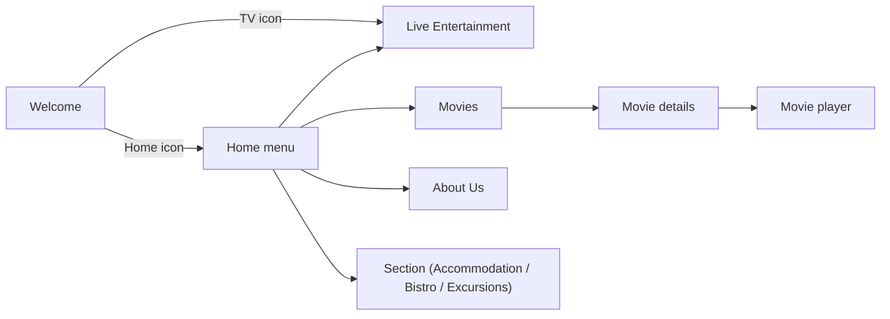
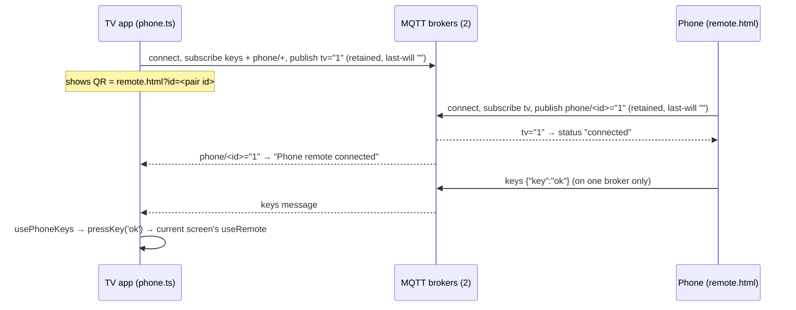
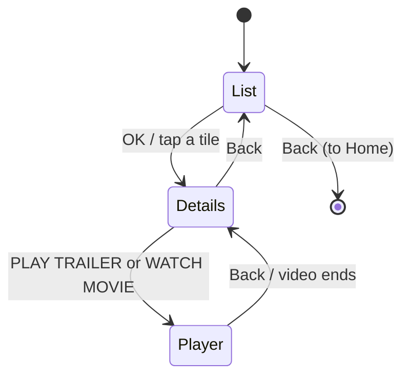
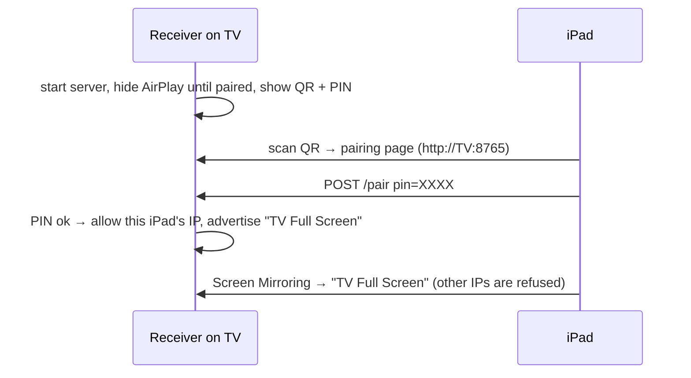

# Boutique Hotels TV Demo: Technical Guide

This guide explains how the demo is built, how each part works, how data and key presses flow
through it, and how it was put together, from the first version to the current one. It's written
for a developer taking over the code. The `README.md` covers running and deploying in short; this
document goes deeper.

---

## 1. What this project is

A **web replica of the mVision hotel TV app** (the interface a guest sees on the room TV),
rebranded for a fictional hotel, "Boutique Hotels". It runs in any browser (TV browser, laptop,
iPad, phone) and is controlled by keyboard, mouse, touch, or a phone acting as a remote.

It's a **static website**: HTML, JavaScript, CSS and media files. There is no backend, no database,
no API key, and no login. All text comes from one JSON file, and all media is bundled.

| Thing | Where |
|---|---|
| Source code | `/Users/Roak/Medianet/somerset-tv-demo` (this folder) |
| Deploy copy (what gets built and uploaded) | `/Users/Roak/Medianet/mvision-web-based/app` |
| Live site | [mvision-demo.vercel.app](https://mvision-demo.vercel.app), also [somerset-mvision-demo.vercel.app](https://somerset-mvision-demo.vercel.app) (same Vercel project) |
| Hotel website embedding it | `https://mvision.mv/live-demo` (inside the site) and `https://mvision.mv/tv-demo/` (app only) |
| Developer handoff zip | `/Users/Roak/Medianet/boutique-hotels-tv-demo.zip` |
| AirPlay receiver for the TV (separate Android app) | `/Users/Roak/Medianet/iphone-mirroring` (see section 9) |

---

## 2. Tech stack and why

| Piece | Choice | Why |
|---|---|---|
| UI | **React 19** + **TypeScript** | Component-per-screen, typed content model |
| Build / dev server | **Vite 8** | Fast dev server with hot reload; outputs a plain static `dist/` |
| Lint | **oxlint** | Fast linter (`npm run lint`) |
| Font | **Roboto** via `@fontsource/roboto` | Same font as the real mVision app, bundled (works offline) |
| QR codes | `qrcode` | QR codes drawn as round-dot SVG to match the TV app |
| Phone remote transport | `mqtt` (MQTT over secure WebSockets) | Phone and TV can be on different networks, no server of our own |
| Media tools (offline scripts) | `yt-dlp`, `ffmpeg`, ImageMagick | Download and encode demo videos, crop images |

No router library, no state library, and no CSS framework are used. Navigation, input and video
are small hand-written modules (described below), which keeps behaviour predictable on TV browsers.

---

## 3. Run, build, deploy

```bash
npm install
npm run dev        # http://localhost:5173 with hot reload
npm run build      # type-checks (tsc -b) and outputs the static site to dist/
npm run preview    # serves dist/ at http://localhost:4173
npx tsc -b && npx oxlint src   # the checks run before every deploy
```

`vite.config.ts` has two important settings:

- `base: './'` makes every asset URL relative, so the built site works at a domain root or in any
  sub-folder (for example `https://mvision.mv/tv-demo/`) without changes.
- Two entry pages: `index.html` (the TV app) and `remote.html` (the phone remote).

The site must be served over `http(s)://`. Opening `dist/index.html` from disk fails because the
browser blocks `fetch('content.json')` on `file://`.

### How the live site is deployed

The live site is a Vercel project (`somerset-mvision-demo`) linked from a **copy** of the source at
`mvision-web-based/app`. Every deploy follows these steps:

```bash
# 1. Copy source to the deploy folder (never copy node_modules, dist, package files, .vercel)
rsync -a --delete --exclude node_modules --exclude dist --exclude .DS_Store \
  --exclude 'package*.json' --exclude .vercel --exclude .git \
  /Users/Roak/Medianet/somerset-tv-demo/ /Users/Roak/Medianet/mvision-web-based/app/

# 2. Build there; keep the Vercel link (dist/.vercel) across the rebuild
cd /Users/Roak/Medianet/mvision-web-based/app
cp -R dist/.vercel /tmp/vercel-bak && npm run build && cp -R /tmp/vercel-bak dist/.vercel

# 3. Upload the built folder as production
cd dist && npx vercel deploy --prod --yes
```

Production is aliased to both `mvision-demo.vercel.app` and `somerset-mvision-demo.vercel.app`.

### How the developer zip is made

Everything except rebuildable folders (`node_modules`, `dist`, `.vercel`, `*.tsbuildinfo`) is
zipped. The developer runs `npm install` and `npm run build` to get `dist/`, then uploads it to
their server.

---

## 4. Folder structure

```
index.html              TV app entry
remote.html             phone remote entry
vite.config.ts          relative base + two entry pages
public/
  content.json          ALL text, menus, channels, movies, sections, theme colours
  assets/img/           images and icons (white line icons are tinted in CSS)
  assets/img/movies/    movie posters (2:3) and list thumbnails (16:9)
  assets/video/         welcome + excursion videos, each with a .jpg poster frame
  assets/video/channels/  one demo clip per TV channel (<CHANNEL_ID>.mp4 + .jpg)
  assets/video/movies/  <movie>-trailer.mp4 and <movie>-movie.mp4 (+ .jpg)
  assets/audio/         home screen music
  assets/docs/          sample bistro menu PDF (target of a QR code)
scripts/
  fetch-channel-videos.py  downloads/encodes channel clips (yt-dlp + ffmpeg)
  fetch-movie-videos.py    downloads/encodes movie trailers and scenes
  bistro-menu.html         source of the sample menu PDF
src/
  main.tsx              mounts <App/>, loads fonts and CSS
  App.tsx               stage scaling, ?fill flag, screen stack, deep links, Back button, volume OSD
  types.ts              TypeScript model of content.json and of routes
  remote.ts             key handling (useRemote), hover(), app context (go/back/home)
  drag.ts               swipe / mouse drag / wheel scrolling inside the scaled stage
  sound.ts              the single shared <video> player, music, volume, sound unlock, pause/seek
  phone.ts              TV side of the phone remote (pairing id, MQTT, incoming keys)
  phoneKeys.ts          phone remote protocol shared by both sides (keys, brokers, topics)
  phone-remote/         the phone remote page (RemoteApp.tsx, remote.css)
  screens/              Welcome, Home, Tv (Live Entertainment), Movies, About, Section
  components/           AppBar, QuickFooter, Qr, Video, StartOverlay, PhonePair, DetailsDrawer, LinkDialog
  index.css             all styling, grouped by screen
```

---

## 5. Core architecture

### 5.1 The 1920×1080 stage (and `?fill`)

Every screen is designed in fixed pixels on a **1920×1080 "stage"**, exactly like the TV app's
layout. `App.tsx` (`useStageScale`) scales the whole stage with a CSS transform to fit the window:

```
scale = min(windowWidth / 1920, windowHeight / 1080)       // normal: letterboxed, never distorted
transform: translate(-50%, -50%) scale(scaleX, scaleY)     // stage centred in the viewport
```

So layout code never deals with screen sizes: positions such as `top: 300px` are always stage
pixels. `drag.ts` divides pointer movement by the current scale to convert screen pixels back to
stage pixels.

**`?fill=1`** switches to a *non-uniform* scale (`x = w/1920`, `y = h/1080`), so the stage fills
the whole window with no black bars. It's remembered in `localStorage` (`stage-fill`) until
`?fill=0`. This exists for **iPad-to-TV mirroring**. The iPad screen is 4:3 and the TV is 16:9. On
the iPad the app looks squeezed, but a receiver that stretches the mirror to 16:9 (see section 9)
shows it undistorted and full screen on the TV.

### 5.2 Content model (`public/content.json`)

The app fetches `content.json` once at start (`App.tsx`), and every screen reads from it through
the app context. Its shape is typed in `src/types.ts`:

| Key | Used by | Contents |
|---|---|---|
| `theme` | `App.tsx` → CSS variables | `--primary`, `--focus-fill`, `--focus-outline`, text/background colours |
| `logo`, `roomNumber`, `appBar`, `footer` | AppBar, QuickFooter | Logo, room no., status icons, footer guide text and icons |
| `welcome` | Welcome | Title, background video and poster |
| `home` | Home | Slider images, interval, music, and the **menu** (cards on the home screen) |
| `sections` | Section | Generic content modules (Accommodation, Belle Amie Bistro, Excursions) |
| `movies` | Movies | Movies on Demand: labels, hint texts, genres → movies |
| `tv` | Tv | Channel categories and channels (logo, optional `video`) |
| `about` | About | Hotel description, image, website, socials |

A **menu item** decides which screen opens:

```json
{ "id": "movies", "label": "Movies", "icon": "assets/img/movies-icon.png", "route": "movies" }
```

`route` is `tv`, `movies`, `about` or `section`. For `section`, the item's `id` is the key in
`sections`. The current menu order is: Live Entertainment, Movies, About Us, Accommodation,
Excursions, Belle Amie Bistro.

### 5.3 Navigation: a screen stack

There is no URL router. `App.tsx` keeps a **stack of routes**:

```ts
type Route = { name: 'welcome' } | { name: 'home' } | { name: 'tv' } | { name: 'movies' }
           | { name: 'about' } | { name: 'section'; id: string }
```

- `go(route)` pushes a screen, `back()` pops one, and `home()` resets to `[welcome, home]`.
- Only the top of the stack is rendered. Each screen component is mounted fresh when shown.
- **Deep links** set the starting stack from the URL hash: `#home`, `#tv`, `#movies`, `#about`,
  `#section/<id>` (`initialStack()`).
- Screens get `content`, `go`, `back` and `home` from `useApp()` (React context in `remote.ts`).



### 5.4 Input: one model for remote, keyboard, mouse, touch and phone

Everything is designed for a **TV remote first** (D-pad + OK + Back), and the other inputs map onto
it.

**Keys → `useRemote`** (`remote.ts`). Each screen registers one handler:

```ts
useRemote((key) => { if (key === 'ok') ...; else if (key === 'left') ... }, enabled)
```

| Physical input | Becomes |
|---|---|
| Arrow keys | `up` `down` `left` `right` |
| Enter / Space | `ok` |
| Escape / Backspace | `back` |
| Phone remote buttons | the same keys via a `remotekey` window event (`pressKey`) |

The `enabled` flag is how overlays take over input. For example, Section disables its own handler
while the details drawer is open, and Movies disables its handler while the player is open.

**Focus is React state, not DOM focus.** Each screen stores what is focused (for example
`{ zone: 'tabs', i: 2 }`) and draws an `is-focused` class. That is how the red focus outline moves
the way it does on the real TV.

**Mouse.** `hover(fn)` moves the focus only when a *real mouse actually moves*. Touch never
changes focus on hover, because iOS swallows the tap if hover changes the page. A cursor that is
just resting there doesn't steal focus when a new screen appears under it. A click selects.

**Touch and drag.** `useDragScroll(axis, scrollBy)` (`drag.ts`) gives swipe, mouse drag and wheel
scrolling for lists (home menu, tabs, channel grid, movie rows). A drag beyond 10 px cancels the
click, so swiping a list doesn't open an item.

**Pointer mode.** When a mouse or touch is used, a **Back** button appears at the top of the
screen (it sends `Escape`). Any real key press hides it again.

### 5.5 Sound and video: one shared player (`sound.ts`)

Browsers (especially iOS) only allow sound after a user gesture, and iOS grants that **per video
element**. If each screen created its own `<video>`, it would start muted again. So the app has
**exactly one `<video>` element** for its whole life:

- `attachPlayer(box, src, loop)` moves that element into the current screen's container and plays
  `src`. It returns a detach function, so a screen being removed stops its video. Only one video
  can ever play, so a channel never keeps playing in the background.
- `Video.tsx` is the React wrapper. It shows the `.jpg` with the same name as the `.mp4` as a
  poster until playback starts. **Every video therefore needs a matching `.jpg`.**
- **Sound unlock:** on load, `StartOverlay` asks for one tap or key press ("Tap anywhere to
  start"). Every real interaction (`pointerdown`, `click`, `keydown`, ...) also retries playback
  with sound.
- **Music** (`playMusic`) plays on the home screen and never at the same time as a video.
- **Volume / mute** from the phone remote changes both video and music, with an on-screen bar.
- **Movie player controls** (added for Movies): `setPaused`, `seekBy`, `seekTo`, `watchPlayer`.
  A `userPaused` flag stops the "retry on every interaction" logic from un-pausing a video the
  guest paused.
- `disableRemotePlayback` / `x-webkit-airplay="deny"` keep video *inside the page* when an iPad is
  mirrored. Otherwise iOS sends just the video to the TV instead of the whole app.

### 5.6 Phone as remote (`phone.ts`, `phoneKeys.ts`, `phone-remote/`)

The guest scans a QR code on the start or welcome screen. The phone opens `remote.html?id=<tv-id>`,
a remote laid out like the mVision remote. Key presses travel through **public MQTT brokers over
secure WebSockets** (`broker.emqx.io:8084` and `broker.hivemq.com:8884`, both at once for
redundancy). The phone and the TV therefore don't need to share a network, and no server of ours
is involved.



- The pairing id is random and stored in `localStorage`, so a phone that already scanned
  reconnects automatically.
- `home`, `menu`, `power`, `volup`, `voldown` and `mute` are handled globally in `App.tsx`. Every
  other key goes to the current screen.
- The retained "online" flags plus MQTT *last will* let each side see the other disappear within
  about 30 s.

---

## 6. Screens and their flows

### Welcome (`screens/Welcome.tsx`)
Background video (`welcome.video`), logo, title, and two icons: **Home** opens the menu, and **TV**
opens Live Entertainment. It also shows the phone-remote QR code.

### Home (`screens/Home.tsx`)
A background image slider (crossfades every `slideIntervalSec`), the home music, and a horizontal
row of menu cards (322 px each). Left/Right move the focus, and the row scrolls to keep the focused
card on screen. Swipe and drag also scroll it. OK or a click opens the card's `route`. The last
focus and scroll position are remembered when you come back.

### Live Entertainment (`screens/Tv.tsx`)
The hotel's channel list:
- **Tabs** (categories) across the top, a **4-column channel grid** on the left, and a
  **preview** on the right playing the tuned channel.
- It opens on the **Sports** tab while the In-House channel plays in the preview.
- Selecting a channel tunes it in the preview, and selecting it again (or the preview) goes
  **full screen**. Full screen shows a channel banner for 5 s. Up/Down or swiping changes channel,
  and OK, Back or a tap exits.
- The **In-House** tab plays its channel full screen immediately (the welcome video). Back returns
  to the tab you came from.
- Each channel plays `channel.video` if set (`assets/video/channels/<ID>.mp4`), otherwise a sample
  clip.

### Movies on Demand (`screens/Movies.tsx`)
Modelled on the Palvision "Movies on Demand" screen, with three views.



1. **List.** Genre rows (Action, Kids, Comedy) of 16:9 tiles. Arrows move through the rows, and
   the list scrolls vertically to keep the focused row visible (two rows fit above the hint bar).
2. **Details.** Cast on the left. In the middle: the title, a meta line (year · running time · age
   rating · genre), the description, and **PLAY TRAILER** / **WATCH MOVIE** buttons. The 2:3 poster
   is on the right.
3. **Player** (`MoviePlayer`). Full-screen video with an on-screen display: poster, title and kind
   at the top, then play/pause and ±10 s buttons, a progress bar with times, and hints. OK pauses
   and resumes, Left/Right skip 10 s, and Back stops. The display hides after 4 s while playing and
   stays while paused. A tap toggles it, and the progress bar can be tapped to seek. When the video
   ends, the player returns to the details view.

A **hint bar** at the bottom shows the remote buttons with meaningful labels for each view. The
labels come from `movies.hints` in `content.json`, and the icons are inline SVGs.

### About Us (`screens/About.tsx`)
Hotel image, description, social icons and a website button. Selecting a link opens a **QR popup**
(`LinkDialog`) to scan with a phone, as on the TV, because nothing navigates away from the app.

### Section (`screens/Section.tsx`): Accommodation, Belle Amie Bistro, Excursions
A generic content screen driven by `sections[id]`. Item tabs across the top, a background image or
video per item, a title and description, an optional **QR code** (for example the bistro menu PDF),
and an optional **"View Details"** button that opens a side drawer (`DetailsDrawer`) of label/value
rows. `kind: 'dining'` vs `'facility'` only changes the layout slightly.

### Shared components
`AppBar` (logo, room, live clock and date), `QuickFooter` (Home / TV shortcuts), `Qr` (round-dot
QR code; relative paths resolve against the site URL), `TintIcon` (colours a white icon PNG with a
CSS mask, the way the TV app tints CMS icons), and `Html` (renders the CMS HTML descriptions).

---

## 7. Media pipeline

| Media | Source | How it was made |
|---|---|---|
| Logo, room/time/date icons, menu icons | mVision CMS export; new logo and Movies icon drawn for this demo | White line-art PNGs, 500×500, transparent; tinted via CSS |
| Movies icon | Drawn with ImageMagick (clapperboard with play symbol) | Matches the filled style of the Live Entertainment icon |
| Home slider, About, Accommodation, Bistro photos | Wikimedia Commons (credits in README) | Cropped to 1920×1080 |
| Welcome / In-House video | Free stock footage + "Island Meet and Greet" (Kevin MacLeod, CC BY 4.0) | `assets/video/welcome-resort.mp4` |
| Channel clips | YouTube (promos and trailers per channel) | `scripts/fetch-channel-videos.py`: 60 s, 720p H.264/AAC, + `.jpg` |
| Movie posters and thumbnails | [TMDB](https://www.themoviedb.org) official English artwork | Poster 780×1170 (2:3); thumbnail = English title backdrop 800×450 (16:9) |
| Movie trailers and scenes | Official studio YouTube channels / Movieclips | `scripts/fetch-movie-videos.py`: trailer in full, scene = first 180 s, 720p CRF 28 |

**Rules that keep media working:**
- Every `.mp4` needs a `.jpg` of the same name (used as the poster while loading).
- Videos are 720p H.264 + AAC with `+faststart`, so they start streaming immediately and play in
  every browser, iOS included.
- Movie assets follow `id`-based names, so `content.json` stays predictable:
  `assets/img/movies/<id>.jpg`, `<id>-thumb.jpg`, `assets/video/movies/<id>-trailer.mp4`,
  `<id>-movie.mp4`.

> The YouTube and TMDB material is for **demo purposes**. For a real deployment, use licensed
> media (the hotel's own VOD files) and point `trailer` / `video` at them.

---

## 8. How to make common changes

**Change text, colours, logo.** Edit `public/content.json` (`theme`, `logo`, `welcome.title`, and
so on). No code changes.

**Add a content module (like Accommodation).**
1. Add an entry under `sections` (`title`, `kind`, `items[]` with `name`, `descriptionHtml`,
   `image`, `video`, `qr`, `qrCaption`, `details[]`).
2. Add a menu item `{ "id": "<same id>", "label": "...", "icon": "...", "route": "section" }` at
   the position you want.

**Remove a module.** Delete its menu item and its `sections` entry (and any images only it used).

**Add a movie.** Add an object to a genre in `movies.categories[].movies`:

```json
{
  "id": "my-film", "title": "My Film", "year": 2024, "duration": "1h 50m", "rating": "PG",
  "cast": "A, B, C", "description": "...",
  "thumbnail": "assets/img/movies/my-film-thumb.jpg", "poster": "assets/img/movies/my-film.jpg",
  "trailer": "assets/video/movies/my-film-trailer.mp4", "video": "assets/video/movies/my-film-movie.mp4"
}
```

Then either drop the files in place, or add the film's YouTube ids to `SOURCES` in
`scripts/fetch-movie-videos.py` and run `python3 scripts/fetch-movie-videos.py my-film`. A new
genre is just a new `{ "name": "...", "movies": [...] }` entry.

**Add a TV channel.** Add it to `tv.channels` (with `category`, `image`, and optional `video`). To
download a clip, add a search query to `SOURCES` in `scripts/fetch-channel-videos.py` and run it
with the channel id.

**Add a new kind of screen** (as was done for Movies):
1. `types.ts`: add the route name to `MenuItem.route` and to `Route`, plus types for its content.
2. `App.tsx`: render it (`{route.name === 'x' && <X />}`) and allow it in `initialStack()` for a
   deep link.
3. `screens/X.tsx`: use `useApp()`, keep focus in state, handle keys with `useRemote`, use
   `hover()` and `useDragScroll` for mouse and touch, and `Video` for video.
4. `index.css`: add a `/* --- x */` block. Positions are in 1920×1080 stage pixels.
5. `content.json`: add the content and a menu item with `"route": "x"`.

**Before handing over or deploying:** run `npx tsc -b && npx oxlint src`, then follow section 3.

---

## 9. iPad mirroring and the AirPlay receiver

### The problem
The sales flow is: show the mVision website on an iPad, open the live demo, and mirror the iPad to
a hotel TV. Two issues came up:
1. **Black bars.** The iPad is 4:3 and the TV is 16:9. Standard AirPlay keeps the 4:3 shape, so the
   TV shows bars on the sides, and the letterboxed 16:9 app inside it adds bars at the top and
   bottom.
2. **Video "jumping" to the TV.** When a video played, iOS sent only the video to the TV instead of
   the mirrored page.

### The solution (two halves)
- **Web side.** `?fill=1` stretches the app to fill the iPad (section 5.1), and
  `disableRemotePlayback` keeps video in the page (section 5.5).
- **TV side.** An AirPlay receiver that can **stretch** the 4:3 mirror to the full 16:9 screen
  cancels out the squeeze, so the TV shows the app undistorted with no bars. Commercial receivers
  (AirScreen) were tested first but have time limits, so an **open-source receiver** was adapted
  instead.

### The receiver app (`/Users/Roak/Medianet/iphone-mirroring`)
A fork of an open-source Android AirPlay receiver (Kotlin/Jetpack Compose UI + the **UxPlay** C
library via JNI). Package `com.medianet.airplay`, installed on the Sony TV next to the TV's
built-in AirPlay app, which was left untouched.

Changes made for this project:

| Change | Where | What it does |
|---|---|---|
| **Stretch mirror** setting | `Prefs.kt` (`STRETCH_MIRROR`), `MainViewModel.kt`, `SettingsScreen.kt`, `MainScreen.kt`, `strings.xml` | Video surface fills the screen instead of keeping the aspect ratio |
| **Only the paired iPad may mirror** | New UxPlay patch `0007-restrict-mirroring-to-paired-client.patch` (`raop.c`, `raop.h`, `httpd.c`), `native_bridge.cpp`, `NativeBridge.kt` (`nativeSetAllowedClient`), `PairingHttpServer.kt`, `AirPlayService.kt` | After the PIN is entered, the device's IPv4 is stored; other devices get HTTP 403. Listening is IPv4-only, so the check can't be bypassed over IPv6 |
| **Wi-Fi lock** | `AirPlayService.kt` | `WIFI_MODE_FULL_LOW_LATENCY` lock while running, to reduce Wi-Fi power-saving lag |
| Settings on the demo TV | app preferences | Port **7010**, name **"TV Full Screen"**, stretch **on**, 1920×1080, **Miracast off** |

**Pairing flow** (pairing gate, already in the fork):



The PIN changes each time the receiver restarts, so after a restart the iPad has to scan and enter
the new PIN again.

**Important lessons from debugging:**
- *"Error starting server"* happened because port 7000 was taken by the TV's own AirPlay. Moved to
  7010.
- *Slow connecting, lag, black screen.* The receiver's **Miracast** feature kept the TV's single
  Wi-Fi radio scanning (Wi-Fi Direct), causing up to 60% packet loss. With Miracast off: 0% loss,
  ~6 ms. **Keep Miracast off on TVs that can't use it.**
- *Other devices still see the receiver name.* AirPlay discovery (mDNS/Bonjour) is network-wide and
  can't be hidden per device. The allowlist makes sure only the paired iPad can actually connect.

**Building and installing the receiver:**

```bash
cd /Users/Roak/Medianet/iphone-mirroring
./gradlew :app:assembleDebug                       # applyUxplayPatches re-applies all patches first
adb connect <TV-IP>:5555
adb install -r app/build/outputs/apk/debug/app-debug.apk   # -r keeps the settings
```

UxPlay source changes **must be patch files** in `app/src/main/cpp/patches/UxPlay/`. The build
resets UxPlay and re-applies the patches each time, so direct edits are lost. Because it's a debug
build, settings can be changed with
`adb shell run-as com.medianet.airplay` (`shared_prefs/settings.xml`).

---

## 10. Development history (what was done, in order)

The app already existed as a Somerset-branded replica when this work started. The changes since
then, grouped by goal:

1. **Rebranding to "Boutique Hotels".** New welcome text and hotel logo; "Somerset" removed from
   all text, QR targets and the bistro menu PDF. A new welcome video with music. New hotel photos
   for the home slider (chosen so the white icons stay readable), About, Accommodation and Bistro.
2. **Live TV fixes.**
   - A video kept playing with sound on other screens. Fixed by the single shared player.
   - The Documentary tab was hidden. The tab strip now scrolls.
   - Mouse hover was changing the preview channel. Hover now only moves focus, and a click plays.
   - It opens on Sports. The In-House tab plays full screen, and Back returns to the previous tab.
   - In-House now uses the welcome video, and channel clips were re-assigned.
3. **Content order.** Excursions moved after Accommodation. Later, Housekeeping, Wellness & Fitness
   and Male' City were removed.
4. **Remote control research.** A physical "solar" hospitality remote, a USB dongle remote and the
   Palvision S400's remote settings were investigated. That direction was dropped at your request,
   and anything done for it was reverted. The **phone remote over MQTT** (section 5.6) replaced it.
   Any remote that acts as a keyboard (arrows, Enter, Escape/Backspace) works anyway through
   `useRemote`.
5. **Handoff and hosting.** A developer zip without `node_modules` or `dist`. The Vercel project
   aliased to `mvision-demo.vercel.app`, and a README written for the developer.
6. **iPad mirroring.**
   - Tested the live site on the TV and the iPad, and diagnosed the 4:3 vs 16:9 problem.
   - Tried a temporary test-only Fullscreen button, then removed it from the developer version.
   - Settled on the `?fill=0/1` flag.
   - Built the receiver changes: stretch, pairing allowlist, Wi-Fi lock, Miracast fix (section 9).
7. **Movies module, first version.** Added a Movies menu item after Live Entertainment with a new
   icon, modelled on the Palvision box (`com.palvision.iptvapp`, inspected over ADB): list,
   details and full-screen video.
8. **Movies module, current version.**
   - Genre-correct English catalogue: Despicable Me 3 moved from Action to Comedy, and two real
     action films added.
   - Official trailers plus official scenes as the videos, replacing the reused channel clips.
   - Sharp TMDB artwork replacing the cropped screenshots.
   - A meaningful remote hint bar.
   - A proper player: progress, pause, seek, end handling.
   - `fetch-movie-videos.py`, so the developer can refresh or replace the videos.

---

## 11. Known limitations and gotchas

- **Autoplay with sound** always needs one tap or key press per page load (browser rule), hence the
  start screen.
- **`file://` doesn't work.** Serve the site over http(s).
- **Hot reload during `npm run dev`.** After editing `sound.ts`, do a full page reload. Hot reload
  can leave two copies of the player module, and the video won't start. Production builds aren't
  affected.
- **Public MQTT brokers** are free, with no guarantees. For production, run your own broker and
  change `BROKERS` in `phoneKeys.ts` (both TV and phone use it).
- **Demo media** (YouTube clips, TMDB art) is for demonstration only. WATCH MOVIE plays a 3-minute
  official scene, not the full film.
- **Age ratings.** 1917 and Mad Max are R, and Mission: Impossible and Jumanji are PG-13. Swap them
  if only family films are wanted.
- **Size.** Media makes the zip about 830 MB (movie videos ~350 MB, channel clips ~480 MB). Lower
  `CLIP_SEC` / `MOVIE_SEC` or the CRF in the scripts to shrink it.
- **Receiver PIN** must be re-entered from the iPad after every receiver restart (by design).
